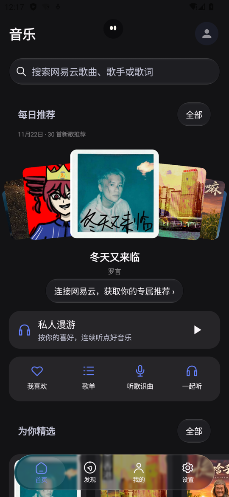
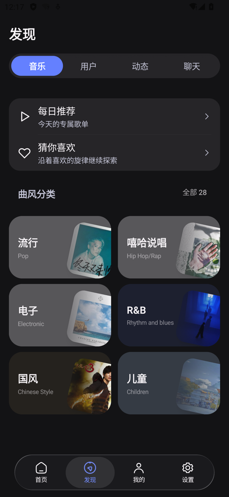
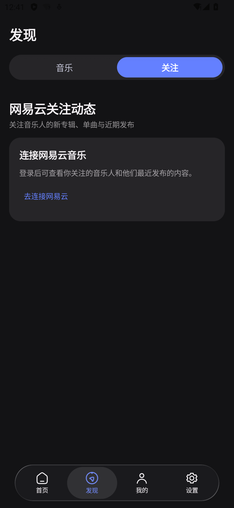
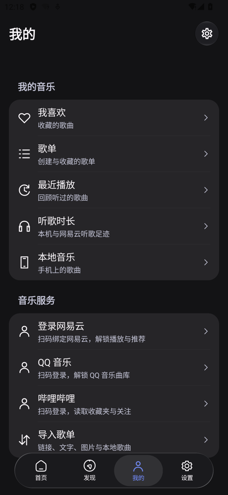
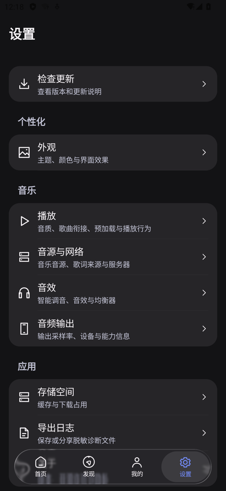

<div align="center">


<h1>PromX</h1>

<sub>♪ 本机音乐终端 · 多曲库联机中 · 今晚也要好好听歌 ♪</sub>

One native Android player for NetEase Cloud Music, QQ Music, Bilibili,
Navidrome, Emby and local audio.<br>
Unified search, playlists, synchronized lyrics, audio effects and listening together.

<p>
  <a href="https://github.com/TusanX/PromX/releases/latest"></a>
  <a href="https://github.com/TusanX/PromX/releases"></a>
  
  <a href="LICENSE"></a>
</p>

<p>
  
  
  
  
</p>

<h4>Download</h4>

<a href="https://github.com/TusanX/PromX/releases/latest"></a>
<a href="https://github.com/TusanX/PromX/issues"></a>

<sub>Latest signed release: 1.6.0 · Android 8.0 / API 26 or newer</sub>

</div>

<p align="center">✦ ━━━━━━━━━━━━━━━━━━━━━ ✦ ━━━━━━━━━━━━━━━━━━━━━ ✦</p>

<table>
  <tr>
    <td align="center" width="33%">
      <h3>🎧 3 sources</h3>
      <sub>NetEase · QQ Music · Bilibili</sub>
    </td>
    <td align="center" width="33%">
      <h3>📚 Libraries</h3>
      <sub>Navidrome · Emby · Local</sub>
    </td>
    <td align="center" width="34%">
      <h3>💿 One player</h3>
      <sub>Search · Lyrics · Effects · Together</sub>
    </td>
  </tr>
</table>

<details open>
<summary><b>💫 Project lineage / 作品从哪里来</b></summary>

PromX is an independently maintained fork of [CurrentMusicX](https://github.com/bileizhen/CurrentMusicX), the native Android client for [CurrentMusic](https://github.com/backrooms-yrc/CurrentMusic). Upstream copyright, third-party notices and license terms are preserved.

PromX 从 [CurrentMusicX](https://github.com/bileizhen/CurrentMusicX) 独立演化而来。CurrentMusicX 是 [CurrentMusic](https://github.com/backrooms-yrc/CurrentMusic) 的原生 Android 客户端。上游版权、第三方声明与许可证继续保留。

</details>

## Features ✨

- **Three primary libraries in one UI.** Switch between NetEase Cloud Music, QQ Music and Bilibili without leaving the player.
- **Additional audio providers.** Choose the Prom service, LeiZ API or an imported LX script when the primary service is unavailable.
- **Private music servers.** Connect directly to Navidrome and Emby, then browse albums, songs, artists and playlists at the source quality allowed by the account.
- **Local music support.** Scan selected folders on the device instead of requesting access to the entire storage volume.
- **Unified discovery.** Daily recommendations, personalized discovery, private roaming, genre browsing, recent plays, liked songs, playlists and listening statistics.
- **NetEase followed-artist feed.** See the artists you follow and their newest releases without the removed community user, post and chat tabs.
- **Search across music and lyrics.** Find songs, artists, albums and playlists, or search using lyrics remembered from a track.
- **A real playback client.** Background playback, media notification, queue management, shuffle, repeat, sleep timer and MV playback.
- **Playback controls that matter.** Select default quality, preload the next track, restore the previous queue and choose whether PromX may mix with other apps.
- **Flexible transitions.** Use smart transitions or a configurable 1–12 second crossfade.
- **Multiple lyric providers.** Automatic matching, Prom lyrics, native NetEase lyrics and embedded local lyrics.
- **Detailed lyric support.** Word timing, translations, romanization, offset adjustment, manual matching and local lyric import.
- **Multiple lyric presentations.** Apple Music-inspired lyrics, animated layouts, font sizing and desktop floating lyrics.
- **Built for Android.** Monet colors, dark mode, liquid-glass surfaces, custom fonts, adaptive navigation and selectable launch animations.
- **Audio tools.** Equalizer, native effects, AI mood controls, speaker scenarios and audio-output diagnostics.
- **Social listening.** Create or join a listening room and keep the playback queue synchronized with friends.
- **Account and library connections.** Sign in to Prom, bind NetEase, QQ Music and Bilibili, or connect self-hosted libraries.
- **Downloads and sharing.** Download songs or MVs, choose a destination, write tags and cover art, export lyrics and share tracks.

## 功能说明 🎼

PromX 是一个使用 Kotlin、Jetpack Compose 与 Miuix 构建的原生 Android 音乐客户端。目标是把国内主流音乐服务、自建曲库与本地音乐放进统一的搜索、播放、歌词和下载体验，同时保留各服务自己的账号与版权限制。

### 多来源音乐库

- 主音乐来源支持 **网易云音乐、QQ 音乐、哔哩哔哩**，可在首页直接切换。
- 网易云支持扫码或验证码绑定，登录后使用本机账号读取推荐、歌单、收藏与播放权限。
- QQ 音乐和哔哩哔哩支持扫码登录，并分别提供对应曲库、收藏夹与关注的浏览入口。
- 支持 **Prom 服务、LeiZ API、落雪 LX 脚本** 等替代音源。LeiZ API Key、服务器账号和会话凭据加密保存在本机。
- 支持连接 **Navidrome / Emby**。可浏览歌曲、专辑、艺术家和我喜欢，使用服务器允许的原音质播放。
- 支持本地音乐扫描。用户可以选择具体文件夹，扫描范围不会默认扩展到整台设备。

### 发现、搜索与歌单

- 提供每日推荐、为你精选、私人漫游、曲风分类、最近播放、我喜欢与歌单管理。
- 发现页提供 **网易云关注动态**，集中展示已关注音乐人和他们的最新专辑、单曲与近期发布。原用户目录、动态和聊天入口已移除。
- 支持歌曲、歌手、专辑和歌单搜索，也可按记得的歌词内容搜歌。
- 支持导入歌单链接、文本、图片和本地歌曲信息。
- 支持网易云与 Prom 两套收藏状态，并可按账号绑定情况自动选择红心目标。
- 我的页面提供本地与网易云听歌足迹，不依赖外部统计服务展示本机播放记录。

### 播放器

- 后台播放、通知栏媒体控制、播放队列、随机、循环、定时关闭与 MV 播放。
- 可选择默认播放音质；实际可用档位取决于音源、歌曲、账号权限和设备输出能力。
- 支持预加载下一首、限制计费网络预加载、恢复上次播放队列和允许与其他应用同时播放。
- 支持智能过渡与可调长度的淡入淡出，关闭后保持标准切歌。
- 播放器、迷你播放器和播放页共享同一套队列与控制状态。

### 歌词

- 歌词来源包括自动择优、Prom、手机直连网易云和本地内嵌歌词。
- 自动模式根据歌曲信息进行匹配，优先采用可用的真实逐字时间。
- 支持逐字高亮、翻译、罗马音、时间偏移、自动对齐和手动匹配。
- 支持 Apple Music 风格歌词、不同字号与排版、动画强度以及桌面悬浮歌词和歌词岛。
- 支持本地歌词导入与导出，不把估算高亮伪装成服务端逐字数据。

### 外观与音效

- 支持深浅主题、纯黑模式、动态取色、液态玻璃、悬浮底栏和自定义字体。
- 开场动画和界面效果可在外观设置中选择，并遵循系统关闭动画的设置。
- 提供均衡器、标准音效、智能音效、AI 情绪调音、AI 调音大师与外放场景入口。
- 音频输出页面显示输出采样率、设备与能力信息，便于检查 USB、耳机和系统混音路径。

### 社交、下载与分享

- 支持创建或加入一起听房间，同步播放队列并与好友互动。
- 支持歌曲与 MV 下载、目录选择、后台进度、取消和失败重试。
- 下载时可写入标题、艺人、专辑、封面和歌词。
- 支持导出歌词、生成分享内容以及使用系统分享面板。

## Screenshots 📸

<p align="center">
  
  
  
  
  
</p>

<p align="center"><sub>♪ Current 1.6.0 build on Android 16 · 界面截图与当前安装版本一致 ♪</sub></p>

## Supported sources 🎚️

| Source | Connection | Main use |
| --- | --- | --- |
| NetEase Cloud Music | Native QR or SMS binding | Search, recommendations, playlists, likes and playback |
| QQ Music | QR login | QQ Music home, library and playback |
| Bilibili | QR login | Bilibili home, favorites, followed creators and video playback |
| Prom | Prom account and selectable server routes | Account services, lyrics and alternate requests |
| LeiZ API | User-provided API key, encrypted locally | Alternate audio provider |
| LX script | Local file or imported script URL | Rule-based alternate source |
| Navidrome | Server address and account | Self-hosted music library |
| Emby | Server address and account | Self-hosted music library |
| Local audio | Folder selection and media permission | On-device music |

Service availability depends on the provider, account region, copyright and network conditions. PromX does not host music files.

## Getting started 🚀

1. Download the latest APK from [Releases](https://github.com/TusanX/PromX/releases/latest).
2. Open **设置 → 音源与网络** and choose a music source and lyric source.
3. Connect NetEase, QQ Music, Bilibili, Navidrome or Emby when the selected feature requires an account.
4. Return to **首页** and search or start from daily recommendations.

## Compatibility 📱

| Item | Requirement |
| --- | --- |
| Android | 8.0 / API 26 or newer |
| Target SDK | Android 16 / API 36 |
| Package | `com.prom.music` |
| Layout | Phones and large screens, portrait and landscape |
| Dynamic color | Android 12 / API 31 or newer |
| Live blur | Android 13 / API 33 or newer |
| Toolchain | JDK 17, SDK 37, NDK 30.0.16248370, CMake 4.1.2 |

## Privacy and data 🔐

- Account credentials, API keys and sessions are stored locally and encrypted where the provider supports it.
- Library requests go directly to the service selected by the user. PromX does not proxy private server traffic.
- Downloaded files are written only to the destination selected by the user.
- Crash and diagnostic logs remain local until the user explicitly exports and shares them.
- Read [PRIVACY.md](PRIVACY.md) for the full data-handling description.

## Build from source 🛠️

Create `local.properties` or set `ANDROID_HOME`:

```properties
sdk.dir=/path/to/android-sdk
```

Build a debug APK:

```bash
./gradlew :app:assembleDebug
```

Build a release APK:

```bash
./gradlew :app:assembleRelease \
  -x lintVitalRelease \
  -x lintVitalAnalyzeRelease \
  -x lintRelease
```

Release signing reads a local, untracked `keystore.properties`:

```properties
storeFile=/path/to/promx-release.jks
storePassword=...
keyAlias=...
keyPassword=...
```

`keystore.properties`, `*.jks`, `local.properties`, `work/` and all build directories are excluded from Git.

## FAQ 💬

<details>
<summary>Why is a song or recommendation unavailable?</summary>

PromX requests content through the selected provider and account. Copyright, membership, regional restrictions and the provider itself can make an item unavailable. Switching source does not bypass those restrictions.

</details>

<details>
<summary>Can different sources share one queue?</summary>

Yes. The player keeps a unified queue while each track retains the source needed to fetch its playback URL, artwork, lyrics and download metadata.

</details>

<details>
<summary>Why are downloaded files different in quality?</summary>

The selected quality is a request to the provider. The final stream or file depends on the track, account entitlement and provider response. Device output capabilities are shown separately in the audio-output page.

</details>

<details>
<summary>Can I install this over another PromX build?</summary>

Only builds with the same signing certificate can upgrade each other. Test signatures used by other developers or CI must be installed separately.

</details>

## Contributors ✨

<p align="center">The player exists because the upstream authors shared their work and the community kept improving it.</p>

<table>
  <tr>
    <td align="center" width="140">
      <a href="https://github.com/TusanX"><br><b>TusanX</b></a><br>
      <sub>PromX maintainer</sub>
    </td>
    <td align="center" width="140">
      <a href="https://github.com/bileizhen"><br><b>bileizhen</b></a><br>
      <sub>CurrentMusicX author<br>direct upstream</sub>
    </td>
    <td align="center" width="140">
      <a href="https://github.com/backrooms-yrc"><br><b>backrooms-yrc</b></a><br>
      <sub>CurrentMusic project<br>original upstream</sub>
    </td>
    <td align="center" width="140">
      <a href="https://github.com/LinYe2804"><br><b>LinYe2804</b></a><br>
      <sub>Upstream contributor</sub>
    </td>
  </tr>
  <tr>
    <td align="center" width="140">
      <a href="https://github.com/KelierAndes"><br><b>KelierAndes</b></a><br>
      <sub>Upstream contributor</sub>
    </td>
    <td align="center" width="140">
      <a href="https://github.com/WhiteXero"><br><b>WhiteXero</b></a><br>
      <sub>Upstream contributor</sub>
    </td>
    <td align="center" width="140">
      <a href="https://github.com/OopsUnix"><br><b>OopsUnix</b></a><br>
      <sub>Upstream contributor</sub>
    </td>
  </tr>
</table>

<details>
<summary>🌟 All upstream contributors / 上游贡献者</summary>

<p align="center">
  <a href="https://github.com/bileizhen/CurrentMusicX/graphs/contributors">
    
  </a>
  <a href="https://github.com/backrooms-yrc/CurrentMusic/graphs/contributors">
    
  </a>
</p>

</details>

## Contributing 🤝

Issues and pull requests are welcome. Please include the app version, device, Android version, reproduction steps and expected result. Remove credentials, local paths, account identifiers and personal listening data from logs or screenshots before posting.

欢迎提交 Issue 和 Pull Request。请说明改动解决的问题、实际验证结果与影响范围，并按独立功能或修复拆分提交。

## Original project and license 📜

- PromX: [TusanX/PromX](https://github.com/TusanX/PromX)
- Direct upstream: [bileizhen/CurrentMusicX](https://github.com/bileizhen/CurrentMusicX)
- Original client project: [backrooms-yrc/CurrentMusic](https://github.com/backrooms-yrc/CurrentMusic)
- Fork and upstream notice: [FORK-NOTICE.md](FORK-NOTICE.md)
- Third-party notices: [THIRD_PARTY_NOTICES.md](THIRD_PARTY_NOTICES.md)

The main project is distributed under GPL-3.0-only. Some included components are distributed under AGPL-3.0-only. Upstream projects and third-party libraries retain their own copyright and license terms.

<div align="center">

**PromX is an independent community project. Please support the services and music you use.**

♪ ━━━━━━━━━━━━━━━━━━━━━ ✦ ━━━━━━━━━━━━━━━━━━━━━ ♪

<a href="#promx">↑ Back to top · 回到顶部</a>

</div>
