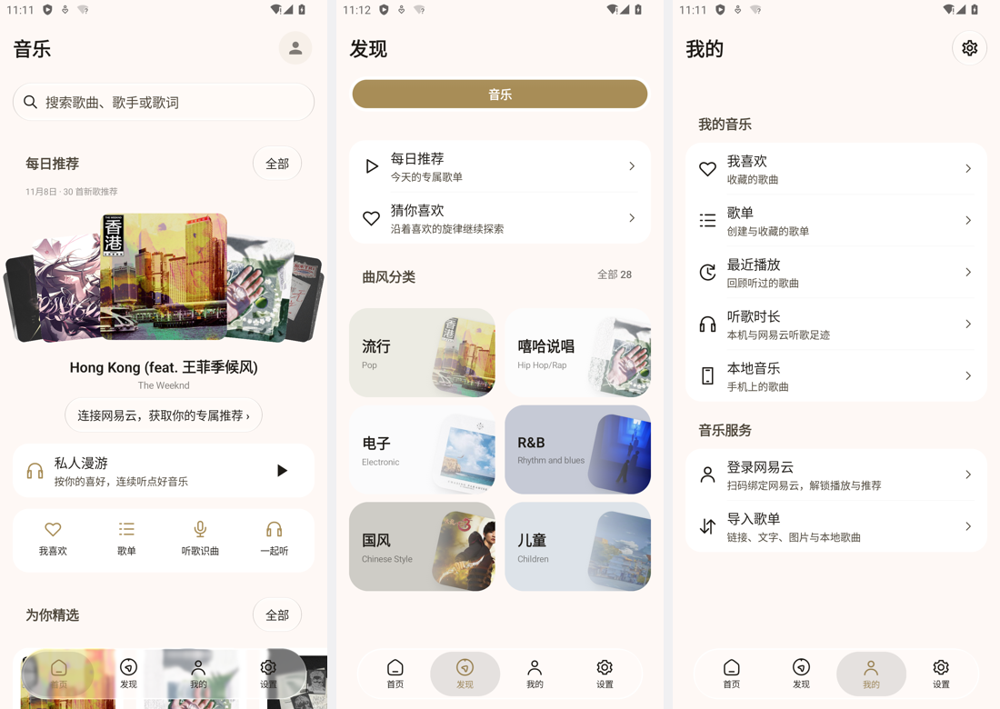

<div align="center">


# PromX

**网易云音乐、QQ 音乐、哔哩哔哩与自建曲库，在同一个原生 Android 播放器里使用。**

Kotlin · Jetpack Compose · Miuix · Material 3

<p>
  <a href="https://github.com/TusanX/PromX/releases/latest"></a>
  <a href="https://github.com/TusanX/PromX/releases"></a>
  
  <a href="LICENSE"></a>
</p>

<a href="https://github.com/TusanX/PromX/releases/latest"><strong>下载 PromX</strong></a>
 · <a href="#功能">功能</a>
 · <a href="#截图">截图</a>
 · <a href="#从源码构建">构建</a>
 · <a href="https://github.com/TusanX/PromX/issues">反馈问题</a>

</div>

PromX 是一个面向 Android 8.0 及以上版本的原生音乐客户端。它把网易云音乐、QQ 音乐、哔哩哔哩、自建 Navidrome / Emby 曲库及本地音乐放进统一的播放、收藏与歌词体验中，并提供多种替代音源和歌词来源。

> **项目来源**<br>
> PromX 是从 [CurrentMusicX](https://github.com/bileizhen/CurrentMusicX) 分出的独立维护版本。CurrentMusicX 是 [CurrentMusic](https://github.com/backrooms-yrc/CurrentMusic) 的原生 Android 客户端。上游来源、改动范围和许可证说明见 [FORK-NOTICE.md](FORK-NOTICE.md)。

## 功能

### 音乐来源

- 首页可在 **网易云音乐、QQ 音乐、哔哩哔哩** 三种主音乐来源之间切换。
- 网易云原生音源支持手机直连，可使用本机网易云账号搜索、播放、收藏和读取推荐。
- 支持 **Prom 服务、LeiZ API、落雪 LX 脚本** 等替代音源。LeiZ API Key 和账号凭据加密保存在本机。
- 支持连接 **Navidrome / Emby** 自建曲库，浏览歌曲、专辑、艺术家和歌单并使用原音质播放。
- 支持本地音乐扫描，可选择扫描目录，不默认读取整台设备。

### 播放与音乐库

- 每日推荐、私人漫游、最近播放、我喜欢、歌单与分类发现。
- 歌曲、歌手、专辑和歌单搜索，并支持按歌词内容搜歌。
- 后台播放、通知栏媒体控制、播放队列、随机、循环、定时关闭和 MV 播放。
- 默认音质选择、预加载下一首、计费网络预加载、恢复上次播放队列。
- 智能过渡或 1–12 秒淡入淡出，可选择是否与其他应用同时播放。
- 支持网易云和 Prom 的收藏目标切换，可按账号状态自动选择。

### 歌词与界面

- 歌词来源支持自动择优、Prom、手机直连网易云和本地内嵌歌词。
- 支持逐字歌词、翻译、罗马音、时间偏移、手动匹配与本地歌词导入。
- 提供 Apple Music 风格歌词和多种歌词排版、字号与动画设置。
- 支持桌面悬浮歌词、歌词岛、主题与动态取色、液态玻璃、自定义字体和开屏动画。
- 提供标准、智能、AI 情绪调音和外放场景等音效入口，并支持均衡器。

### 账号、社交与分享

- Prom 账号、网易云扫码与验证码绑定、资料管理、听歌足迹。
- 支持与好友创建或加入一起听房间，同步播放队列。
- 支持歌曲和 MV 下载、目录选择、后台进度及失败重试。
- 支持把封面、标题与歌词写入下载文件，并可导出歌词和分享内容。

功能是否可用取决于对应服务、账号权限、歌曲版权及网络环境。PromX 不托管音乐文件。

## 截图

<p align="center">
  
</p>

<p align="center"><sub>界面以当前安装版本为准。</sub></p>

## 下载与安装

前往 [Releases](https://github.com/TusanX/PromX/releases/latest) 下载最新 APK。

- 包名：`com.prom.music`
- 最低系统：Android 8.0 / API 26
- 目标系统：Android 16 / API 36
- 当前发布版本：`1.5.2`
- 同签名版本可以直接覆盖升级

## 从源码构建

环境要求：

- JDK 17
- Android SDK Platform 37.0
- Android Build Tools 36.0.0
- NDK `30.0.16248370`
- CMake `4.1.2`

通过 `ANDROID_HOME` 或 `local.properties` 指定 Android SDK 路径：

```properties
sdk.dir=/path/to/android-sdk
```

构建 Debug APK：

```bash
./gradlew :app:assembleDebug
```

构建 Release APK：

```bash
./gradlew :app:assembleRelease \
  -x lintVitalRelease \
  -x lintVitalAnalyzeRelease \
  -x lintRelease
```

正式签名从本机未入库的 `keystore.properties` 读取：

```properties
storeFile=/path/to/promx-release.jks
storePassword=...
keyAlias=...
keyPassword=...
```

`keystore.properties`、`*.jks`、`local.properties` 和构建目录均已排除，不应提交到仓库。

## 项目来源与许可

- 直接上游：[bileizhen/CurrentMusicX](https://github.com/bileizhen/CurrentMusicX)
- 原始客户端项目：[backrooms-yrc/CurrentMusic](https://github.com/backrooms-yrc/CurrentMusic)
- PromX 上游说明：[FORK-NOTICE.md](FORK-NOTICE.md)
- 第三方组件与版权声明：[THIRD_PARTY_NOTICES.md](THIRD_PARTY_NOTICES.md)
- 隐私说明：[PRIVACY.md](PRIVACY.md)

主工程按 GPL-3.0-only 分发，部分组件按 AGPL-3.0-only 分发。各上游项目及第三方库继续保留原有版权与许可证。

## 反馈与贡献

提交 Issue 时请附上应用版本、手机型号、Android 版本、复现步骤和实际结果。提交 PR 时请说明改动范围与验证结果，并避免把账号、Token、签名文件或用户数据带入仓库。
